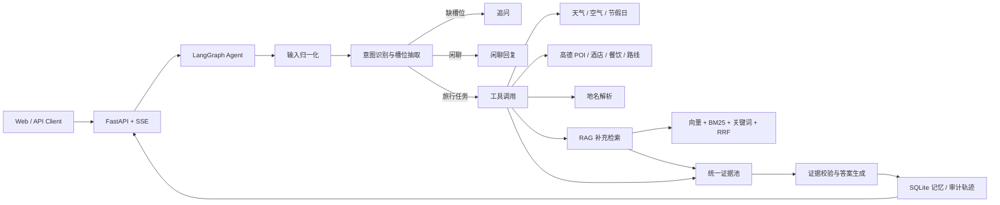

# Travel Assistant · 旅游规划助手

> 面向旅行问答的可追溯 Agent：LangGraph 状态编排、API-first 工具调用、RAG 补充检索与逐句证据绑定。

[](https://github.com/Qinghe9/Travel-assistant/actions/workflows/ci.yml)
[](https://github.com/Qinghe9/Travel-assistant/actions/workflows/ai-review.yml)


Travel Assistant 是一个面向真实旅游场景的全栈 RAG Agent 示例。它将用户问题拆解为意图与槽位，优先调用天气、地图、路线和生活服务 API，再使用本地旅行知识库补充背景，最终生成带来源编号、可审计、可降级的中文回答。

项目覆盖从数据采集、清洗、切片、索引、混合检索，到多轮对话、长期记忆、SSE 流式输出和自动评测的完整链路。

<details>
<summary>目录</summary>

- [为什么值得一看](#为什么值得一看)
- [系统架构](#系统架构)
- [功能特性](#功能特性)
- [当前评测](#当前评测)
- [快速开始](#快速开始)
- [Docker](#docker)
- [API](#api)
- [项目结构](#项目结构)
- [测试与评测](#测试与评测)
- [数据与安全边界](#数据与安全边界)
- [持续集成](#持续集成)
- [贡献](#贡献)

</details>

## 为什么值得一看

- **API-first，RAG-supplemented**：实时数据优先来自工具，RAG 只补充景点、美食、文化等知识背景。
- **全国行政地名解析**：省级、地级市、县级与县级市按 `scope → 高德 geocode → GeoNames` 三级顺序解析。
- **复合意图处理**：一句话可同时触发行程、天气、交通、美食和住宿任务。
- **证据可追溯**：事实句绑定 `source_id`，无依据句子会被删除或触发抽取式降级。
- **多轮与跨会话记忆**：短期上下文按 `thread_id` 保存，偏好和目的地按 `user_id` 持久化。
- **完整工程化**：FastAPI、SSE、离线冒烟、pytest、RAG 评测、TTFT 评测和 Docker 配置齐备。

## 系统架构



核心原则：

1. 实时事实只来自工具 API。
2. RAG 不得覆盖天气、票价、余票等实时字段。
3. 缺少证据时拒答或使用原文抽取，不生成估计值。
4. 每个可核查事实句都应绑定来源。

## 功能特性

### Agent 与对话

- 七类意图：目的地、行程、交通、住宿、美食、天气、闲聊。
- JevK5、LLM 与规则引擎三级路由。
- 支持复合意图、多轮槽位继承、省略终点和指代消解。
- 支持“为什么推荐”“重新回答”“相同问题复用”等快捷分支。
- SSE 流式事件：`meta → step → token → final`。

### RAG 检索

- 数据采集、许可登记、清洗、切片和地理对齐。
- 向量、BM25、标题/关键词三路召回。
- RRF 融合与可选重排。
- 进程内热索引，避免每次查询往返向量数据库。
- 证据压缩、逐句引用校验、数字校验与实词覆盖校验。

### 旅游工具

| 能力 | 数据源 | 说明 |
|---|---|---|
| 天气 | Open-Meteo / 高德 | 支持连续多日预报 |
| 空气质量、节假日 | ShowAPI | 县级无监测点时标注上级行政区 |
| 景点、酒店、餐饮 | 高德 Web 服务 | 县级检索中心透传、近重复 POI 合并 |
| 驾车、步行、公交 | 高德 Web 服务 | 铁路余票仍以 12306 为准 |
| 航班、铁路 | Travelport | 未配置凭据时明确不可用 |
| 全国地名 | scope / 高德 / GeoNames | 覆盖地级市与县级地名 |

### 工程能力

- FastAPI 非流式与 SSE 流式接口。
- 短期 SQLite Checkpointer 与长期 LangGraph Store。
- 完整会话记录、偏好管理、Trace 查询和反馈接口。
- HTML、CSS、JavaScript 与 Python 路由分离。
- 无密钥离线冒烟、pytest 回归和评测门禁。

## 当前评测

以下结果来自当前本地快照，评测日期为 **2026-10-26**。

| 指标 | 当前结果 | 说明 |
|---|---:|---|
| RAG Recall@3 | **98.20%** | 388 条查询，产品过滤路径 |
| RAG MRR | **95.92%** | 产品过滤路径 |
| RAG nDCG@3 | **95.13%** | 产品过滤路径 |
| Hard-negative 无关知识 | **0** | 按评测集显式负例统计 |
| 证据 `source_id` 绑定率 | **100%** | 返回候选均带可引用 ID |
| 检索 P95 | **10 ms** | 热索引、过滤路径 |
| 首 Token P50 | **846 ms** | 20 次真实 SSE |
| 首 Token P95 | **1011 ms** | 20 次真实 SSE |
| 完整响应 P95 | **2343 ms** | 观测值，不作为 TTFT 门禁 |

> Recall@3 的正式门禁使用 Agent 实际传入城市/类别过滤的 `filter` 模式。无过滤 `open` 模式仅用于诊断，不应当与产品路径指标混用。

评测报告：

- [RAG 基线（历史提交）](evals/baseline.json)
- [TTFT 结果](evals/agent_ttft.json)
- [意图回归评测](evals/intent_metrics.json)

> 已提交 RAG 基线记录 Recall@3 为 98.45%；当前代码重跑为 98.20%，两次结果均通过 95% 门禁。

## 快速开始

### 环境要求

- Python 3.12
- Windows、Linux 或 macOS
- 可选：Docker 与 Docker Compose

### 1. 安装依赖

```bash
git clone https://github.com/Qinghe9/Travel-assistant.git
cd Travel-assistant

python -m venv .venv

# Windows PowerShell
.\.venv\Scripts\Activate.ps1

# Linux / macOS
# source .venv/bin/activate

python -m pip install --upgrade pip
python -m pip install -r requirements.txt
```

### 2. 配置环境变量

```bash
# Linux / macOS
cp .env.example .env

# Windows PowerShell
Copy-Item .env.example .env
```

至少需要配置对话模型与 Embedding 服务：

```dotenv
DEEPSEEK_API_KEY=your_deepseek_key
RAG_EMBED_API_KEY=your_embedding_key
```

可选工具：

```dotenv
AMAP_API_KEY=your_amap_web_service_key
SHOWAPI_APP_KEY=your_showapi_key
JEV_APP_KEY=your_jev_key
```

> `.env` 已被 `.gitignore` 排除。不要提交真实密钥。

### 3. 准备知识库

仓库不包含原始数据、向量索引和 SQLite 数据库。

```bash
python scripts/fetch_datasets.py --list
python scripts/fetch_datasets.py --only zhwikivoyage,geonames-cn
python scripts/check_dataset_ready.py

# 生成全国地级市与县级 scope
python scripts/build_scope.py --all --level both

# 先构建小样本，确认配置无误
python scripts/build_index.py --limit 200

# 构建完整索引
python scripts/build_index.py --rebuild
```

完整数据构建方法见 [scripts/](scripts/)；第三方许可与署名见 [NOTICE](NOTICE)。

### 4. 启动服务

```bash
python scripts/run_api.py
```

开发模式：

```bash
python scripts/run_api.py --reload
```

访问：

| 页面 | 地址 |
|---|---|
| 对话页面 | http://127.0.0.1:8001/demo |
| Swagger | http://127.0.0.1:8001/docs |
| 健康检查 | http://127.0.0.1:8001/health |

### 5. 命令行体验

```bash
python scripts/run_agent.py "帮我规划3天西安行程，天气怎么样"
python scripts/run_agent.py "婺源有什么好玩的" --json
python scripts/run_agent.py "凯里明天天气" --show-trace
```

## Docker

```bash
docker compose up --build
```

服务默认监听 `8001`。容器使用非 root 用户、只读根文件系统、持久化 `./data`，并配置健康检查。

如需独立 Chroma 服务：

```bash
RAG_CHROMA_MODE=http docker compose --profile chroma up --build
```

## API

| 方法 | 路径 | 用途 |
|---|---|---|
| `POST` | `/api/v1/chat` | 对话，支持普通 JSON 与 SSE |
| `GET` | `/api/v1/traces/{trace_id}` | 查询请求审计轨迹 |
| `GET` | `/api/v1/profile/{user_id}` | 查询长期偏好 |
| `GET` | `/api/v1/profile/{user_id}/memory` | 导出跨会话对话记录 |
| `POST` | `/api/v1/memory/import` | 导入本地旧会话 |
| `POST` | `/api/v1/feedback` | 点赞/点踩 |
| `GET` | `/api/v1/feedback/export` | 导出反馈 CSV |
| `GET` | `/health` | 服务与依赖健康状态 |

请求示例：

```bash
curl -X POST http://127.0.0.1:8001/api/v1/chat \
  -H "Content-Type: application/json" \
  -d '{
    "message": "敦煌3天行程，天气怎么样",
    "user_id": "demo-user",
    "thread_id": "demo-thread",
    "stream": false,
    "smart_search": true
  }'
```

## 项目结构

```text
app/
├── agent/                 LangGraph、意图、槽位、记忆、流式与工具编排
├── api/
│   ├── main.py            FastAPI 入口与依赖预热
│   ├── routes.py          对话、记忆、反馈与轨迹 API
│   ├── demo.py            页面路由
│   ├── templates/         HTML 页面
│   └── static/            CSS、JavaScript 与静态图片
├── models/                Pydantic 数据模型
├── rag/
│   ├── indexing/          采集、清洗、切片、地理索引与构建
│   ├── retrieval/         向量、BM25、关键词、RRF、重排与热索引
│   └── generation/        提示词、LLM、引用校验与抽取兜底
└── tools/                 天气、高德、ShowAPI、路线与工具注册表

evals/                     RAG、意图、延迟评测
scripts/                   数据、索引、启动、冒烟与运维脚本
tests/                     pytest 回归测试
docs/                      AI 开发档案与会议记录
```

## 测试与评测

全量测试：

```bash
python -m pytest -q
```

离线冒烟：

```bash
python scripts/smoke_agent_offline.py
python scripts/smoke_api_offline.py
python scripts/smoke_fetch_offline.py
```

RAG 评测：

```bash
python evals/run_rag_eval.py --mode both
```

意图评测：

```bash
python evals/run_intent_eval.py
```

真实 SSE TTFT：

```bash
python evals/run_agent_ttft.py \
  --base-url http://127.0.0.1:8001 \
  --runs 20 \
  --gate 2.0
```

## 数据与安全边界

- `data/`、索引、数据库和 `.env` 不属于代码快照，需要按部署环境自行生成。
- 当前已构建知识库由公开旅行语料构成，不等同于企业内部私有知识库。
- 工具实时数据有供应商覆盖范围；县级空气质量和部分服务可能回退到上级行政区。
- 航班、铁路正式票价与余票依赖授权供应商，系统不会在没有 API 时猜造结果。
- 引用校验和接地校验能降低幻觉风险，但不能数学保证所有自然语言蕴含关系。
- 2 秒指标按首 Token `TTFT P95` 定义；完整响应 P95 单独观测。

## 数据许可

本项目不重新许可第三方数据。维基导游、维基百科、GeoNames、ChinaTravel、ModelScope 等数据的使用、署名与分发条件以 [NOTICE](NOTICE) 为准。项目代码如需对外再分发，应由仓库所有者补充明确的代码许可证。

## 持续集成

GitHub Actions 当前执行：

- ruff 高信号静态检查
- 全工程 Python 语法编译
- 数据源适配器离线冒烟
- Agent 图结构、记忆、引用绑定与降级冒烟
- FastAPI、SSE 和反馈接口冒烟

PR 可选启用 AI Review。Fork PR 无法读取仓库 Secret 时会自动跳过。

## 贡献

1. 从 `main` 创建功能分支。
2. 保持提交聚焦，推荐使用 `feat:`、`fix:`、`refactor:`、`test:`、`docs:`。
3. 新功能必须附测试，涉及检索或生成时同步更新评测。
4. 不要提交 `.env`、密钥、原始数据、向量索引或本地数据库。
5. 提交 PR 前运行全量测试与离线冒烟。

## 致谢

感谢维基导游、维基百科、GeoNames、ChinaTravel、ModelScope 数据提供方，以及 FastAPI、LangGraph、Chroma、jieba 等开源项目。

第三方数据来源、许可证和署名要求详见 [NOTICE](NOTICE)。
