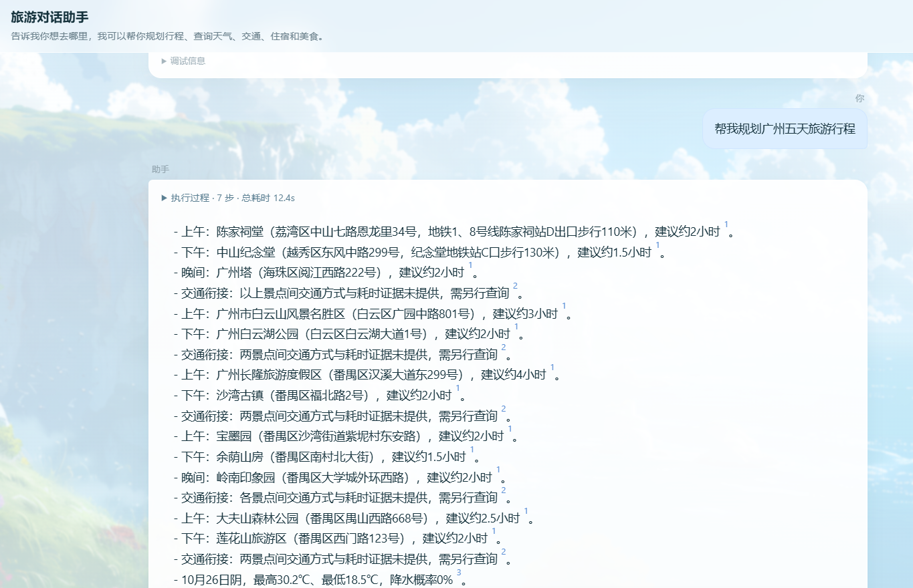
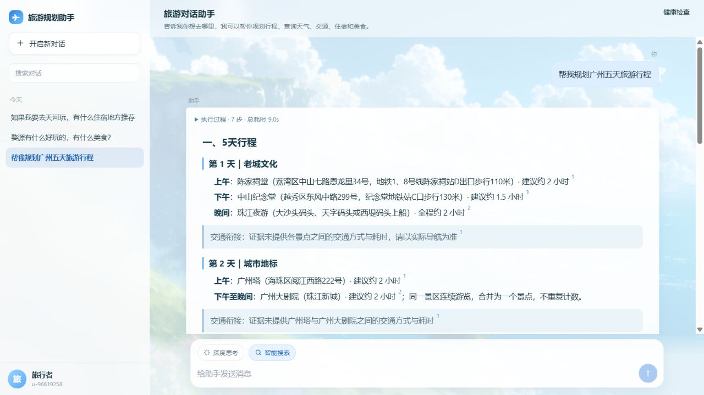
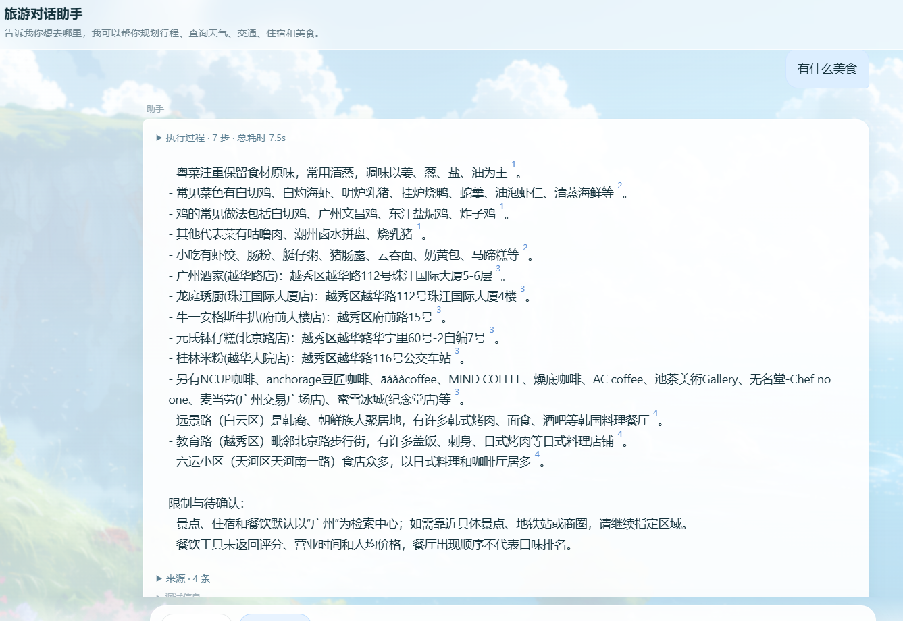
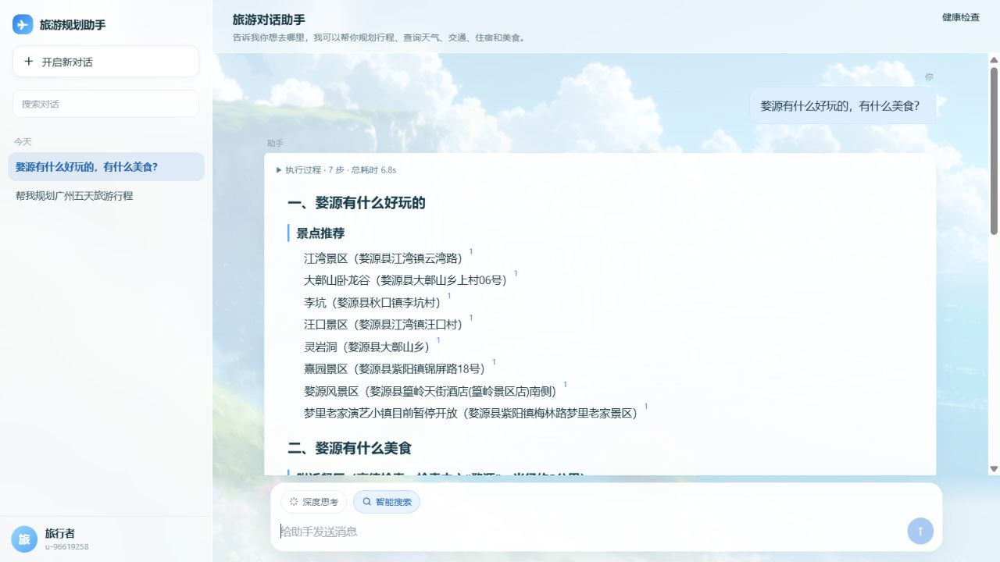
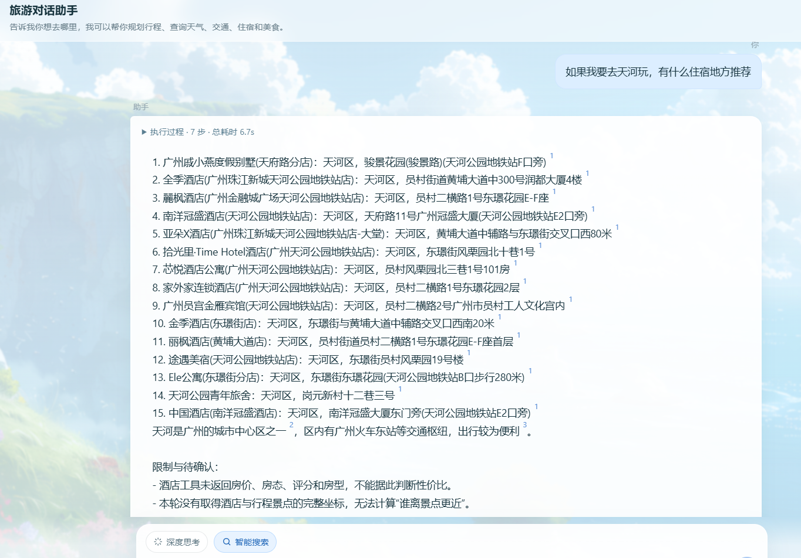
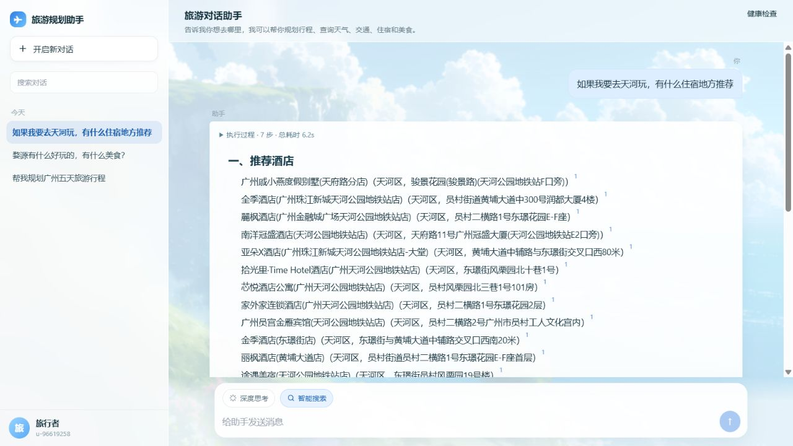

# T37-R 豆包式分级答案格式

## 提示词原文

> 将长答案升级为“分级标题 + 加粗重点 + 引用块”三层结构。
> 行程使用 `# 一、N天行程`、`## 第 N 天｜主题`、`**上午/下午/晚间**`；
> 系统缺口和待确认统一放入 `> ` 引用块。
> 前端必须渲染 Markdown 子集，不能把 `**`、`##` 当作字面量显示。

## AI 原始输出与问题

- 行程、景点和餐厅全部使用同一级 `-` 列表，页面像一堵墙。
- 模型输出 `**景点推荐**` 时，前端显示字面量星号。
- 天气、交通衔接、限制与待确认和事实列表混在同一层级。
- 逐句引用校验要求事实句带引用，新标题天然无引用，存在被误删风险。

## 根因

1. Compose 提示词没有强制 Markdown 视觉骨架。
2. `post_validate` 把所有非空行都当事实句，没有结构行豁免。
3. 前端 `renderAnswer` 只把 `[n]` 转为上标，其余文本使用 `textContent`。
4. 流式 token 直接替换整段纯文本，半行 Markdown 会闪现原始标记。

## 修改

- `prompts.py` 为行程、美食、住宿、景点、天气和交通注入固定分级格式。
- `post_validate` 将标题和引用块识别为结构行，不要求 source_id、不进入绑定率分母。
- 新增保守天标题兜底：只有日期范围或逐日天气能确认天数，且上午分组数量一致时才插入。
- `_ensure_task_headings` 统一输出 `## 任务名`。
- 系统状态、上下文说明、省级默认和限制统一改为引用块。
- 新增无第三方依赖的 `markdown.js`，支持：
  - `#` / `##` 标题
  - `**粗体**`
  - `> ` 引用块
  - `- ` 列表
  - `[n]` 引用上标
- 流式输出按完整行缓冲，未闭合行不参与 Markdown 渲染。

## 复测

### 广州五天行程：改前

### 广州五天行程：改后

真实 DOM 结果：

- 顶级标题：3
- 天级标题：5
- 引用块：7
- 字面量 `**` / `##`：0

### 婺源景点与美食：改前

### 婺源景点与美食：改后

景点与美食分别成节；正文没有字面量 Markdown 标记。

### 天河住宿：改前

### 天河住宿：改后

输出包含 `# 一、推荐酒店` 与 `# 二、区域说明`。

自动化结果：

- T37-R 相关测试：13 项通过
- 全量 pytest：50 项通过
- JavaScript `node --check`：通过
