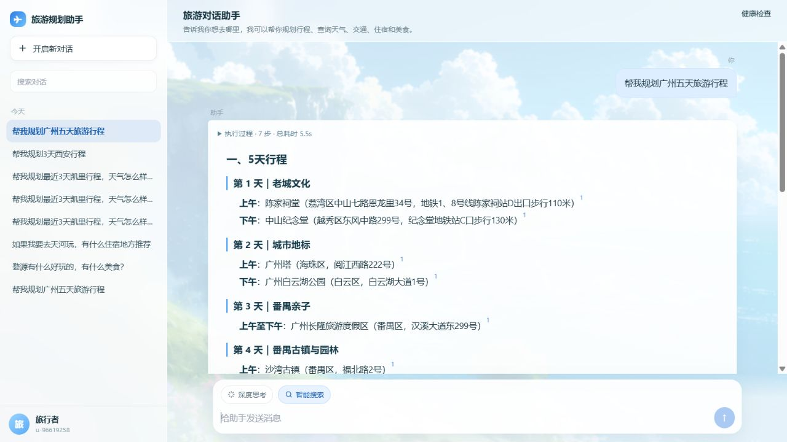

# T40 行程条件字段与暂停 POI 治理

## 提示词原文

> 骨架字段全部为条件字段：只有证据包含对应信息时才输出该行；没有证据就省略整行。
> 禁止逐日输出“证据未提供/需另行查询”式占位句，系统缺口只在“使用说明”汇总一次。
> 暂停开放的 POI 必须从上游候选中剔除，并在使用说明中披露。

## AI 原始输出与问题

- 凯里每天出现“交通衔接：证据未提供……”“晚间：证据未提供……”占位行。
- 云谷田园已经标注暂停开放，模型仍将其排入第 3 天，再自行提示不宜前往。
- 节假日结果把内部布尔值直接展示成“是否假日为 True，节日为无”。
- 占位句抬高了绑定率分母，且让有效行程被噪声淹没。

## 根因

1. 提示词把骨架字段当成必填项，诱导模型生成占位说明。
2. 暂停状态只存在于 POI 候选字符串中，没有在工具结果层过滤。
3. 节假日工具直接暴露结构化布尔字段，未提供用户可读文案。
4. 逐日后处理只识别单时段字段，未覆盖“上午至下午”等合并时段变体。

## 修改

- 在 `prompts.py` 顶部写入长期条件字段规范，并将交通、晚间示例改为“仅证据存在时输出”。
- 程序删除字段名后紧跟“证据未提供/证据未给出/需另行查询”的整行。
- 合并时段 `上午至下午`、`下午至晚间`、`上午至晚间` 同样执行占位清理。
- 工具结果进入证据池前删除暂停开放 POI，包括列表和坐标点。
- compose 前的候选提示明确禁止将暂停 POI 写入任何时段。
- 使用说明自动加入“XX 已暂停开放，未排入行程 [n]”。
- `validate_plan` 记录暂停候选剔除，并保留审计 trace。
- `showapi_holiday` 输出“2026-10-26为周一，非节假日”等可读文案，不再暴露布尔值。

## 复测

### 凯里三天：改前

### 凯里三天：改后

真实结果：

- 条件字段占位行：0
- 云谷田园进入时段：0
- 使用说明披露云谷田园暂停开放：是
- 证据绑定率：100%

### 西安三天：改后

“西安城墙步行全长约 11.4km，步行全程约 3–3.5 小时”有证据，完整保留。

### 广州五天：改后

五天标题结构没有回退，且没有逐日占位行。

自动化结果：

- T40 相关测试：16 项通过
- 全量 pytest：54 项通过
