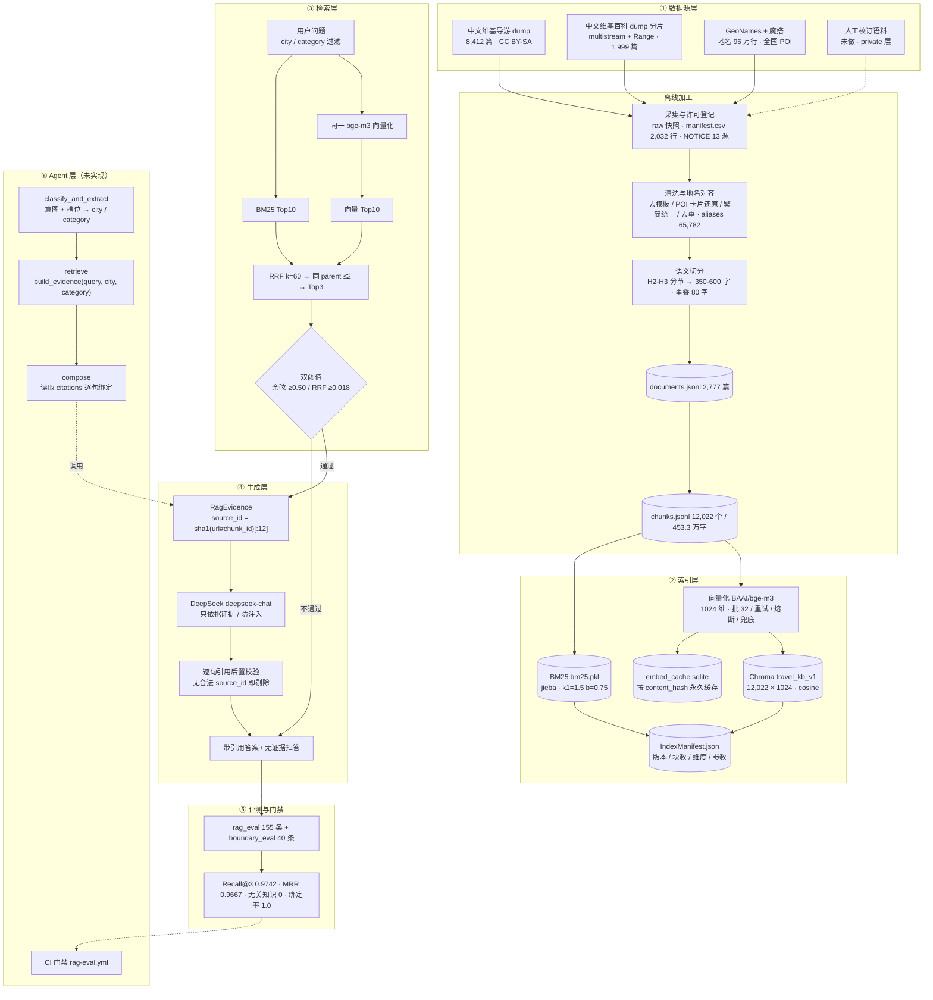

# RAG 模块系统架构

> 架构图：[system_architecture.png](<system_architecture.png>)（由 scripts/draw_architecture.py 生成）
> 状态：核心链路已实现并验收通过；虚线部分为尚未实现的 Agent 层与 CI 门禁。

## 一句话

**离线把多源语料加工成可检索的私有知识库，在线用「向量 + BM25 双路召回 → RRF 融合 → 强约束生成 → 逐句引用校验」交付每句都能追源的答案。**

## 分层结构




## 代码结构（三个子包）

```
app/rag/
  __init__.py            对外接口：build_index / search / build_evidence
  config.py              全部配置（.env 优先）
  indexing/              建库：数据源 -> 清洗 -> 切分 -> 向量化 -> 建索引
    sources/             维基导游 dump / 维基百科 dump 分片 适配器
    clean.py             去模板、POI 卡片还原、繁简统一、段落去重
    split.py             H2/H3 分节 + 350-600 字切分 + 类别打标
    geo.py               GeoNames 地名索引与别名
    align.py             别名词表（备选实现）
    embed.py             BGE-M3 API + 缓存 + 熔断 + 本地兜底
    build.py             Chroma 集合 + BM25 索引 + IndexManifest
  retrieval/             检索：召回 -> 融合 -> 证据装配
    recall.py            向量召回 + BM25 召回（过滤下推）
    fuse.py              RRF 融合、同源去重、双阈值
    evidence.py          RagEvidence 与 source_id 引用绑定
  generation/            生成：提示词 -> 对话模型 -> 引用校验
    llm.py               DeepSeek 客户端（超时/重试/结构化错误）
    answer.py            证据注入、逐句引用后置校验、无证据拒答
```

入口脚本仍在 ```scripts/```：```run_clean.py``` / ```run_split.py``` / ```run_wikipedia.py``` /
```build_index.py``` / ```verify_index.py``` / ```ask.py``` / ```build_rag_eval.py```；
评测在 ```evals/run_rag_eval.py```。

依赖方向是单向的：```generation -> retrieval -> indexing```，没有反向引用。

## 关键设计决策

| 决策 | 选择 | 理由 |
|---|---|---|
| 向量模型 | BGE-M3（1024 维） | 多语言、长文本、免费；**建库与查询必须同一模型**（代码里有强制校验） |
| 向量库 | Chroma 本地持久化（可切 http 容器） | 课程项目免 Docker 也能跑，切换只改一个环境变量 |
| 词法路 | jieba + rank_bm25 | 专有名词与地名靠这一路兜底，弥补向量对生僻实体不敏感 |
| 融合 | RRF（k=60） | 只用排名不用分数，避免两路分数量纲不可比 |
| 同源上限 | 同 parent 最多 2 条 | 防单篇文档刷屏（流程文档 9.4） |
| 无证据判据 | **向量余弦相似度** ≥0.50 为主，RRF 分为辅 | RRF 分是纯排名、无绝对语义；余弦实测域内 0.53~0.76 / 域外 0.36~0.48，完全可分 |
| 引用粒度 | chunk 级（source_id） | 成本低、够用，符合 PRD 6.4 口径 |
| 生成约束 | 每句必须带 `[source_id]`，后置校验剔除违规句 | 把"100% 基于私有知识"变成可执行的代码约束，而不是靠提示词自觉 |

## 两条必须遵守的接口约定

1. **`search()` / `build_evidence()` 必须传 `city`** —— 不传会有 50% 以上的返回是别的城市（实测 open 模式无关知识 52.6%）。
2. **问"有哪些景点 / 有什么好吃的"必须带 `category`** —— 只传 city 时，"成都有哪些必去的景点"会检索到地铁线路 chunk，LLM 只能正确拒答；带 `category=attraction` 后能产出 10 个带引用的景点事实句。

## 当前指标（evals/baseline.json）

| 指标 | 实测 | 目标 | 状态 |
|---|---:|---|---|
| Recall@3 | 0.9742 | ≥0.95 | 达标 |
| MRR | 0.9667 | ≥0.90 | 达标 |
| 无关知识引入 | 0 条 | 0 条 | 达标 |
| 证据绑定率 | 1.0000 | 100% | 达标 |
| 无证据拒答率 | 1.00 | ≥0.90 | 达标 |
| 检索时延 P95 | 409 ms | ≤300 ms | **未达标** |

## 复现命令

```powershell
python scripts/run_clean.py --scope china --skip-links   # 清洗与地名对齐
python scripts/run_split.py                              # 语义切分
python scripts/build_index.py --rebuild                  # 建索引
python scripts/verify_index.py                           # 索引验收（10 项）
python evals/run_rag_eval.py --mode both                 # 评测
python scripts/ask.py "成都有哪些必去的景点" --city 成都 --category attraction
python scripts/draw_architecture.py                      # 重画架构图
```
